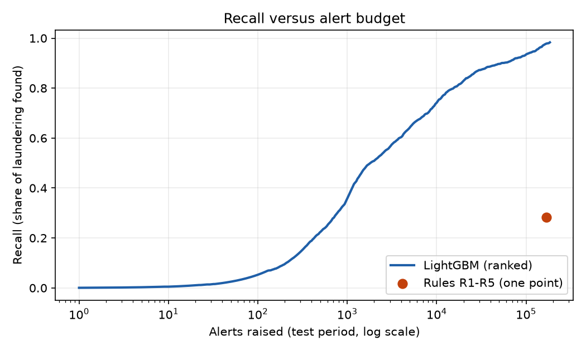

# IBM AML: rules versus LightGBM

Data: IBM HI-Small (5078345 transactions, 5177 laundering, base rate 0.1769% in the test period). Temporal split 60/20/20 by time; the threshold is chosen on validation, and every number below is the **test** period.

## Overall (test period)

| System | Alerts | Precision | Recall | Minority F1 | PR-AUC | Precision@100 |
|---|---|---|---|---|---|---|
| Rules (any of R1-R5) | 167778 | 0.0030 | 0.283 | 0.006 | n/a | n/a (no ranking) |
| LightGBM | 1655 | 0.5317 | 0.490 | 0.510 | 0.460 | 0.95 |
| Hybrid (model OR R3) | 18383 | 0.0521 | 0.533 | 0.095 | n/a | n/a |
| LightGBM − payment format | 2477 | 0.2006 | 0.277 | 0.233 | 0.159 | 0.73 |

## Each rule alone (test period)

| Rule | Alerts | Precision | Recall |
|---|---|---|---|
| R1 | 2550 | 0.0035 | 0.005 |
| R2 | 130875 | 0.0015 | 0.112 |
| R3 | 16823 | 0.0065 | 0.061 |
| R4 | 12240 | 0.0114 | 0.078 |
| R5 | 10161 | 0.0067 | 0.038 |
| any_rule | 167778 | 0.0030 | 0.283 |

## Recall by typology (test period)

| Typology | Rules | LightGBM | Hybrid |
|---|---|---|---|
| BIPARTITE | 0.108 | 0.486 | 0.486 |
| CYCLE | 0.284 | 0.459 | 0.459 |
| FAN_IN | 0.139 | 0.715 | 0.723 |
| FAN_OUT | 0.293 | 0.721 | 0.721 |
| GATHER_SCATTER | 0.222 | 0.773 | 0.778 |
| RANDOM | 0.209 | 0.570 | 0.570 |
| SCATTER_GATHER | 0.333 | 0.631 | 0.683 |
| STACK | 0.171 | 0.507 | 0.507 |
| UNLISTED | 0.426 | 0.013 | 0.148 |

The hybrid adds R3, the rule with the best F1 on UNLISTED transactions in the training period (never chosen on test).

## Class weight (chosen on validation PR-AUC, never on test)

| Weight on the laundering class | Validation PR-AUC |
|---|---|
| 1.0 | 0.3116 |
| 10.0 | 0.0249 |
| balanced | 0.0144 |

Chosen: 1.0.

Most-used model features (split counts): receiver_in_degree (132), log_amount_paid (126), sender_in_out_ratio (123), payment_format_code (114), sender_sent_1h (108), receiver_received_1h (106), sender_out_degree (94), sender_sent_7d (91).

## Feature importance (total gain, full model)

| Feature | Gain | Share |
|---|---|---|
| log_amount_paid | 273056 | 30.2% |
| sender_sent_1h | 216887 | 24.0% |
| receiver_in_degree | 91700 | 10.2% |
| sender_in_out_ratio | 80572 | 8.9% |
| payment_format_code | 63143 | 7.0% |
| sender_sent_7d | 47551 | 5.3% |
| receiver_received_1h | 45940 | 5.1% |
| sender_out_degree | 33805 | 3.7% |
| is_currency_change | 19771 | 2.2% |
| receiver_received_7d | 16628 | 1.8% |
| sender_sent_24h | 6582 | 0.7% |
| receiver_received_24h | 4410 | 0.5% |
| payment_currency_code | 1499 | 0.2% |
| is_cross_bank | 1191 | 0.1% |
| is_round_amount | 64 | 0.0% |
| is_very_round_amount | 0 | 0.0% |

## Alert budget (test period)

| Alert budget | Recall | Precision |
|---|---|---|
| 167,778 | 0.978 | 0.0105 |
| 50,000 | 0.897 | 0.0322 |
| 25,000 | 0.854 | 0.0614 |
| 10,000 | 0.742 | 0.1334 |
| 1,655 | 0.490 | 0.5317 |

The model needs **715 alerts** to match the rules' recall of 28.3%.

## Investigations of the top 20 test alerts

- Investigated the 20 highest-scored test alerts; 19 of them are truly laundering.
- Typology accuracy against the patterns file, top 20 alerts: graph checks + fallback 7 of 19 (37%); classifier only 8 of 19 (42%).
- Typology accuracy, every test-period laundering row with a listed typology: graph checks + fallback 542 of 1339 (40%); classifier only 499 of 1339 (37%).
- Graph checks decided 60% of the top 20 and 48% of all test rows; the classifier filled the rest. Settings chosen on the training period: fan degree k = 8, cycles up to 5 payments.
- Typologies suggested for the top 20: Bipartite, Fan-in, Gather-scatter, Scatter-gather.
- Graph checks look at the 7-day payment neighbourhood (cycle, scatter-gather, bipartite, fan-in/out, gather-scatter). The fallback is a LightGBM classifier trained on training-period laundering rows only. Each investigation is saved in `results/ibm_investigations.jsonl`; nothing is filed or sent.

## Notes

- Rule thresholds were set by looking at the first 60% of the timeline only.
- Amounts are in each row's own currency; there are no exchange rates, so amount features are rough.
- Features use only past transactions. Account degree and in/out ratio are running totals,
  not whole-dataset values.
- Rules only say yes or no, so PR-AUC and precision@100 do not apply to them.
